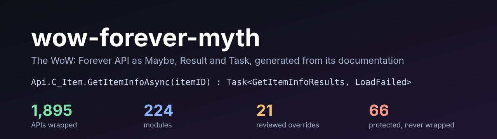

<p align="center">
  
</p>

# wow-forever-myth

**Documentation: [braden1996.github.io/wow-forever-myth](https://braden1996.github.io/wow-forever-myth/)**

The World of Warcraft: Forever API in [luau-true-myth](https://github.com/Braden1996/luau-true-myth) idioms, for
strict Luau addons compiled to Lua 5.1 with darklua. Every wrapper is **generated** from the result shapes that
[wow-forever-luau-types](https://github.com/Braden1996/wow-forever-luau-types) derives from Blizzard's own API
documentation, plus a small table of reviewed overrides for what the documentation cannot say.

```luau
local C_Item = require("wow-forever-myth/src/Api/C_Item")
local ForeverMyth = require("wow-forever-myth/src/ForeverMyth")
local Api, Maybe, Result, Task = ForeverMyth.Api, ForeverMyth.Maybe, ForeverMyth.Result, ForeverMyth.Task

local title = Maybe.unwrapOr(Api.C_QuestLog.GetTitleForQuestID(questID), "an unknown quest") -- Maybe<string>

local message = Result.match(Api.C_AddOns.LoadAddOn("MyAddon_Data"), { -- Result<true, string>
	Ok = function(_loaded: true): string return "loaded" end,
	Err = function(reason: string): string return "not loaded: " .. reason end,
})

Task.inspect(Api.C_Item.GetItemInfoAsync(6948), function(item: C_Item.GetItemInfoResults) -- waits for ITEM_DATA_LOAD_RESULT
	print(item.itemName, item.itemLevel)
end)
```

- **Opt-in per call site.** The raw API is untouched: `C_Item.GetItemInfo` still works; `Api.C_Item.GetItemInfo` is
  the wrapped one. Wrappers look the raw function up at call time, so hooks and late-loaded APIs are respected.
- **Strict types end to end.** Parameter types come from the definitions; record fields carry Blizzard's documented
  result names; `Maybe` appears only where the documentation says a value may be nil.
- **Never wraps a protected function.** Anything Blizzard flags `IsProtectedFunction` is out of scope.
- **Lua 5.1.** `dist/ForeverMyth.lua` is the darklua bundle (luau-true-myth included); CI runs every test against it
  in an environment with only Lua 5.1's standard library and a fake WoW API.

## What gets wrapped

The generator reads `api-shapes.json` (one entry per function and widget method) from a pinned release of
wow-forever-luau-types:

| Shape in `api-shapes.json`                                            | Wrapper                                                                                                                   | Example                                         |
| --------------------------------------------------------------------- | ------------------------------------------------------------------------------------------------------------------------- | ----------------------------------------------- |
| `maybe`: one result that may be nil                                   | `Fn(...): Maybe<T>` and `FnInto(reuse, ...)`                                                                              | `Api.C_Map.GetPlayerMapPosition(map, "player")` |
| `record`: two or more results                                         | `Fn(...): FnResults` (a read-only record with the documented names; nilable fields are `Maybe`) and `FnInto(record, ...)` | `Api.UnitPosition("player").positionX`          |
| `record` that may return nothing (`absent`)                           | `Fn(...): Maybe<FnResults>`                                                                                               | `Api.C_Item.GetItemInfo(id)`                    |
| `value`, `void`, `variadic`                                           | none: call the raw API                                                                                                    | `UnitLevel("player")`                           |
| `protected`, `generic`, `overloaded`, `untyped`, `excluded`, `opaque` | none                                                                                                                      |                                                 |

Widget methods live under `ForeverMyth.Widgets.<Type>` and take the object first:
`Widgets.ScriptRegion.GetPoint(frame, 1)`. Global functions are under `Api` directly; namespaced ones under
`Api.<Namespace>`. Record types are exported by each module: `require(".../src/Api/C_Item").GetItemInfoResults`.

### Reviewed overrides

[`overrides/`](packages/libraries/luau/pure/generator/src/overrides) holds what the documentation cannot express. Every entry states `why`, is validated against
`api-shapes.json` at generation time, and has its own tests (the test runner fails on an untested override).

| File                                                                                    | Meaning                                                                    | Wrapper                                 |
| --------------------------------------------------------------------------------------- | -------------------------------------------------------------------------- | --------------------------------------- |
| [`Results.luau`](packages/libraries/luau/pure/generator/src/overrides/Results.luau)     | a boolean-first result means success or failure, with a named error result | `Fn(...): Result<true or FnSuccess, E>` |
| [`Loads.luau`](packages/libraries/luau/pure/generator/src/overrides/Loads.luau)         | a nil means "not cached yet": a request API fires a load event             | `FnAsync(...): Task<T, LoadFailed>`     |
| [`Callbacks.luau`](packages/libraries/luau/pure/generator/src/overrides/Callbacks.luau) | a callback parameter fires exactly once                                    | `FnAsync(...): Task<T, never>`          |

## Cost

Wrappers are plain functions created once at load; a call does no varargs packing and creates no closures.

| Call                                  | Allocates per call                                                                   |
| ------------------------------------- | ------------------------------------------------------------------------------------ |
| `Fn` returning `Maybe`, value absent  | nothing (`Nothing` is a shared singleton)                                            |
| `Fn` returning `Maybe`, value present | one `Just` table                                                                     |
| `Fn` returning a record               | the record, plus one `Just` per present nilable field (and one for `Maybe<record>`)  |
| `FnInto(reuse, ...)`                  | nothing once warm: it refills the record or `Maybe` you pass and reuses its cells    |
| `Fn` with a `Result` override         | one `Ok`/`Err` table (and the success record, if any)                                |
| `FnAsync`                             | a `Task`, its resolvers and a closure; cached data resolves at once without an event |

`FnInto` is for hot paths (an `OnUpdate` arrow, a per-frame position read). It **overwrites** the record you pass,
so do not keep references to an old value:

```luau
local position = Api.UnitPosition("player")
frame:SetScript("OnUpdate", function()
	position = Api.UnitPositionInto(position, "player") -- same table every frame, no garbage
end)
```

The bundle holds every wrapper (about 1.2 MB of Lua). For a smaller addon, bundle from source and require only the
modules you use: `require("wow-forever-myth/src/Api/C_Item")`.

## Install

- **Plain Lua addon:** add the release's `ForeverMyth.lua` to your `.toc` before your files; it stores the library as
  `ns.ForeverMyth`.
- **Strict Luau addon with Woof (recommended):** add `wow-forever-myth` to `woof.toml` and run `woof install` (or
  `sgt install` with the `"woof"` plugin). Woof unpacks the library, brings in the pinned `luau-true-myth` and
  `wow-forever-luau-types` releases transitively, and wires `.luaurc` aliases (`@forevermyth`, `@truemyth`) and
  definitions automatically.
- **Manual darklua setup:** unpack `wow-forever-myth-<version>.zip` and point `@truemyth` in `.luaurc` and darklua's
  `bundle.require_mode.sources` at the `luau-true-myth` release pinned in `woof.toml`, then type-check with the
  `wow-forever-luau-types` definitions pinned in `woof.toml`.

## Development

Set up the tools and preset tarballs in [CONTRIBUTING.md](CONTRIBUTING.md), then:

| Command                                | What it does                                                                                |
| -------------------------------------- | ------------------------------------------------------------------------------------------- |
| `mise exec -- sgt install`             | install Bun and Woof dependencies from the workspace lockfiles                              |
| `mise exec -- sgt check`               | format, lint, typecheck, boundaries, and static checks                                      |
| `mise exec -- sgt test`                | run the workspace unit tests                                                                |
| `mise exec -- sgt build`               | build the Lua 5.1 bundle and the Astro site                                                 |
| `mise exec -- sgt run generate`        | regenerate `packages/libraries/luau/wow/forever-myth/src/Api`, `Widgets`, and their indexes |
| `mise exec -- sgt run bundle`          | build `dist/ForeverMyth.lua`                                                                |
| `mise exec -- sgt run bundle-specs`    | run every spec against the bundle in a fake WoW world                                       |
| `mise exec -- sgt run luajit-smoke`    | run the bundle under LuaJIT (Lua 5.1, as in WoW) through its runtime paths                  |
| `mise exec -- sgt run fixtures-update` | rewrite the negative fixtures' `.expected` files                                            |
| `mise exec -- sgt run banner`          | redraw the banner                                                                           |

See [CONTRIBUTING.md](CONTRIBUTING.md). MIT licence; the bundle includes luau-true-myth (MIT).
